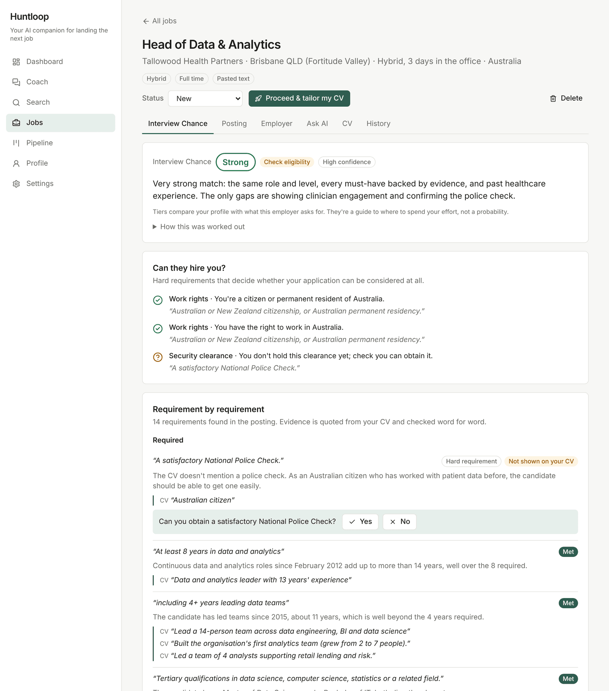
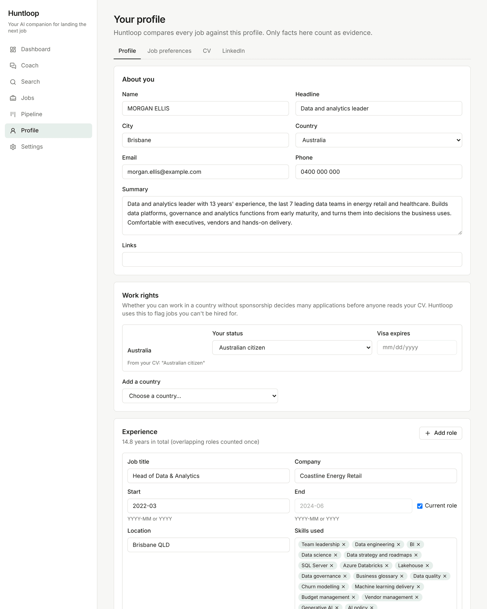
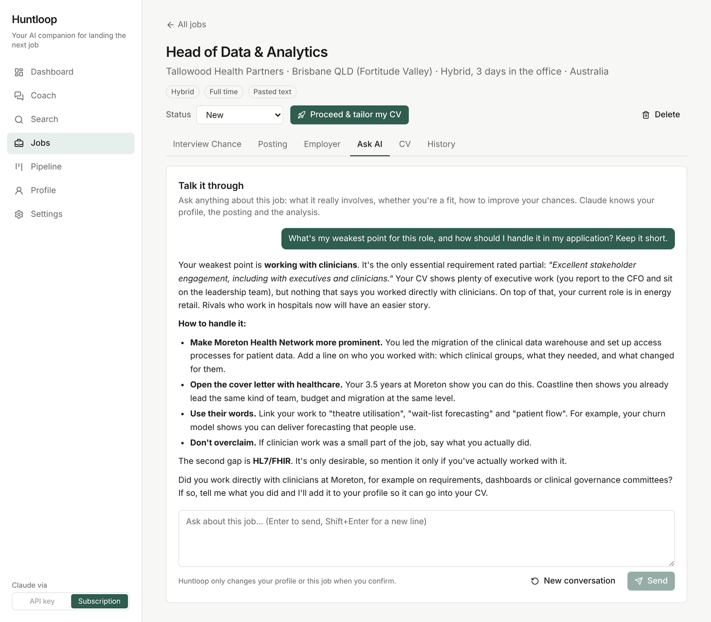
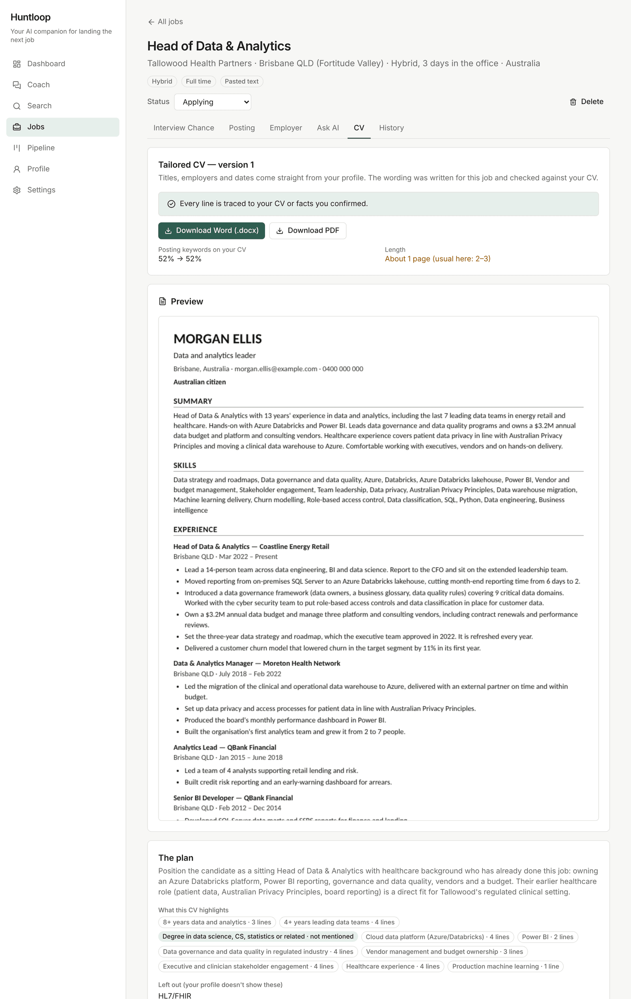
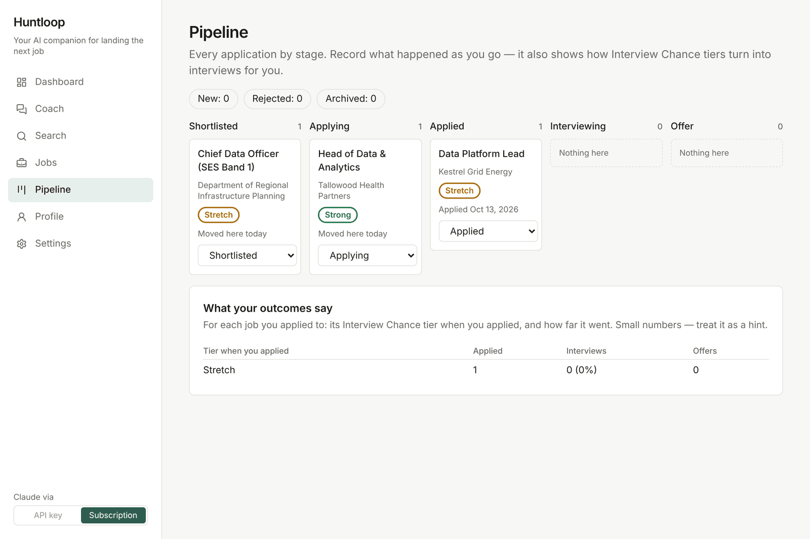
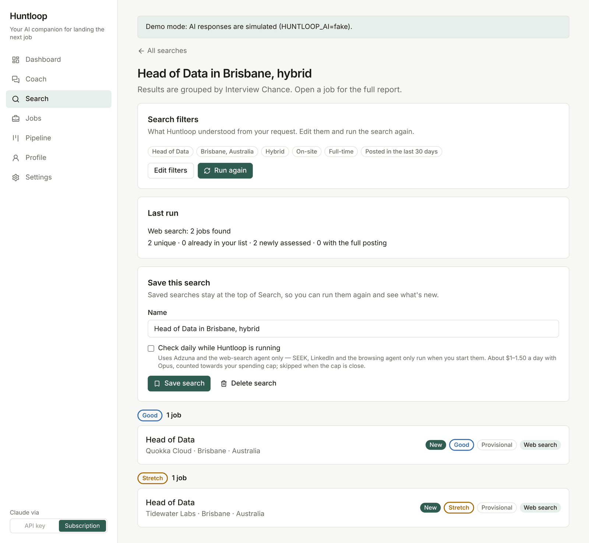
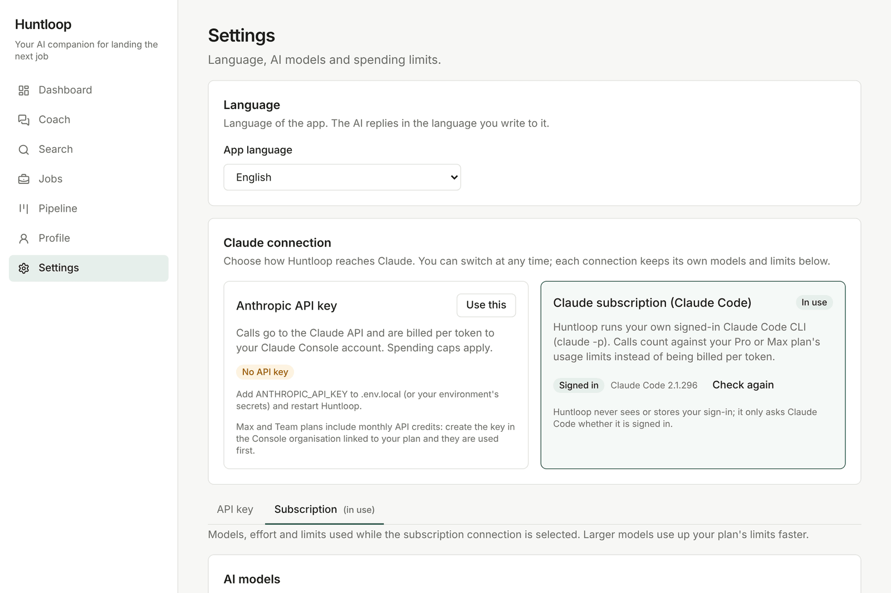

# Huntloop

English | [한국어](README.ko.md)

A job-hunting app that runs on your own computer. Give it your CV and the jobs you're looking at, and it tells you
which ones you have a real shot at and why. When you decide to apply, it writes a CV for that job where every line
traces back to something you actually wrote.

Built for Australia first (NZ, Singapore and the US work too). English and Korean UI. Runs on Claude, through an API
key or your own Claude subscription.



## What it does

- Reads your CV into a profile: roles, dates, skills, work rights per country.
- Takes a job as a link, pasted text, screenshots or a PDF, and rates your chance of an interview: Strong, Good,
  Stretch or Long shot. Every point is backed by a quote from the ad and from your CV.
- Lets you chat with Claude about any job, and researches the employer with sources.
- Writes a tailored CV (Word and PDF). Anything it can't trace to your CV is flagged and blocks the download.
- Tracks your applications on a pipeline board, with a coach chat across all of them.
- Searches for jobs through Adzuna and a Claude web-search agent. SEEK and LinkedIn are optional.

## Screenshots

<table>
  <tr>
    <td><br>Profile from a CV</td>
    <td><br>Asking about a job</td>
  </tr>
  <tr>
    <td><br>Tailored CV with its checks</td>
    <td><br>Pipeline</td>
  </tr>
  <tr>
    <td><br>Search results (demo mode)</td>
    <td><br>API key or subscription</td>
  </tr>
</table>

<sub>The candidate and employers are made up. Taken with Claude Opus 5.5 on a Claude subscription.</sub>

## Getting started

You need Node.js 20.9 or newer.

```bash
npm install
cp .env.example .env.local
npm run build && npm start   # http://127.0.0.1:3000
```

Without a Claude connection the app runs in demo mode with simulated answers, so you can try everything for free.
Your data stays on your machine in `./data`.

## Connecting Claude

Pick one in **Settings → Claude connection**. You can switch any time.

- **API key**: put `ANTHROPIC_API_KEY` in `.env.local`. Billed per token, with daily and monthly caps you set.
- **Claude subscription**: install Claude Code (`npm install -g @anthropic-ai/claude-code`), run `claude auth login`,
  then press **Check again** and **Use this** in Settings. Usage counts against your Pro or Max plan instead of a bill.

Huntloop never sees your Claude sign-in; it only runs your own `claude` command. A whole run (reading a CV, rating three
jobs, a chat, a tailored CV) is about $1 at API prices.

SEEK and LinkedIn are off by default. Their terms don't allow automated access, so read the notice in Settings before
turning them on.

## More

The [guide](docs/guide.md) covers everything in detail: how the rating works, the CV checks, search and the browsing
agent, the Claude connection and costs.

| Command | What it does |
|---|---|
| `npm run dev` | Development server |
| `npm run lint && npm run typecheck && npm test` | Checks to run before committing |
| `npm run test:e2e` | Browser tests with simulated AI |

MIT licence.
