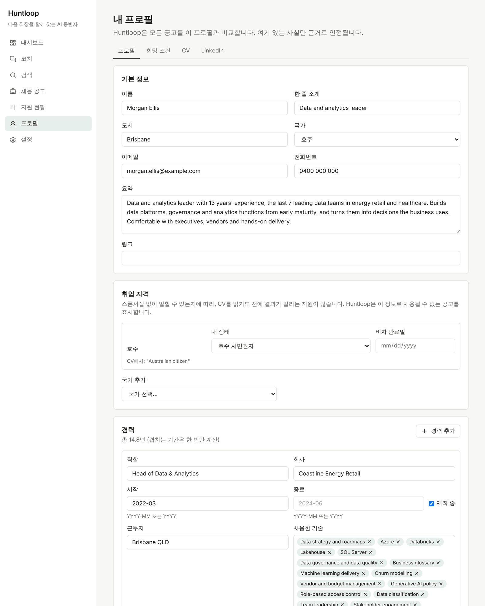
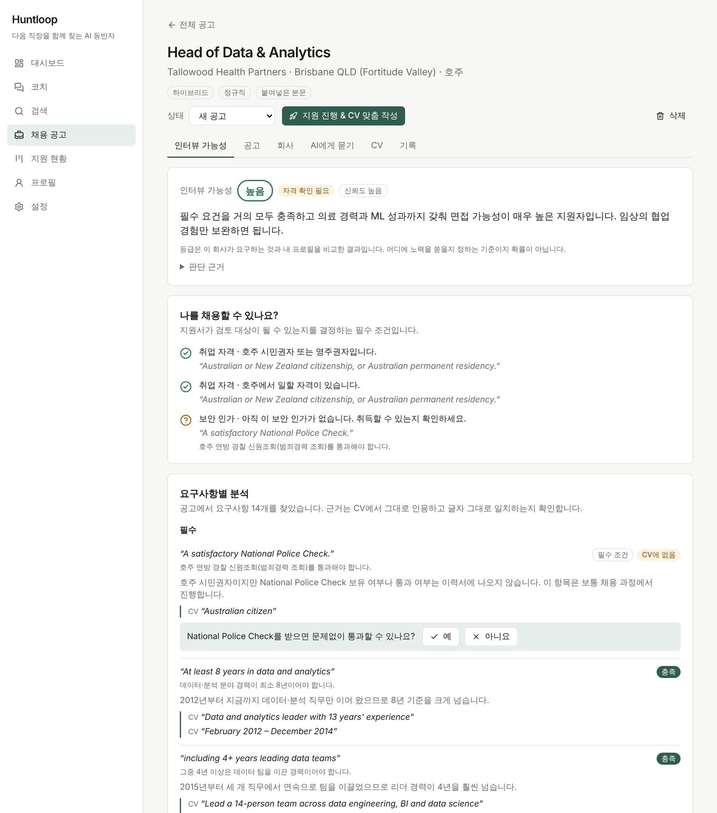
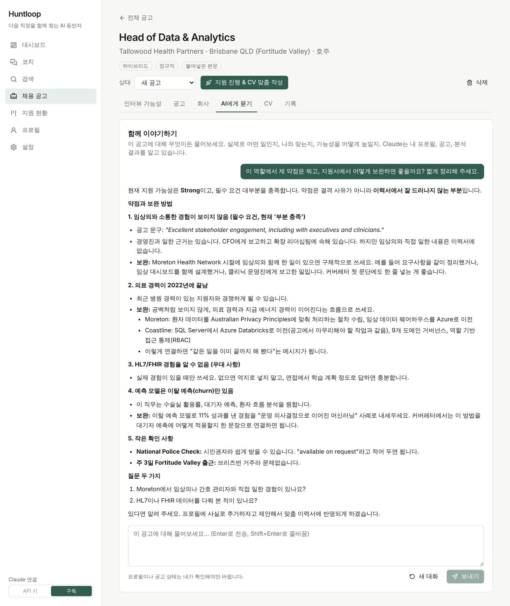
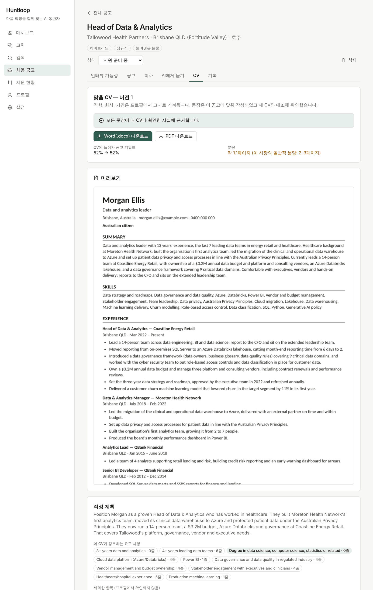
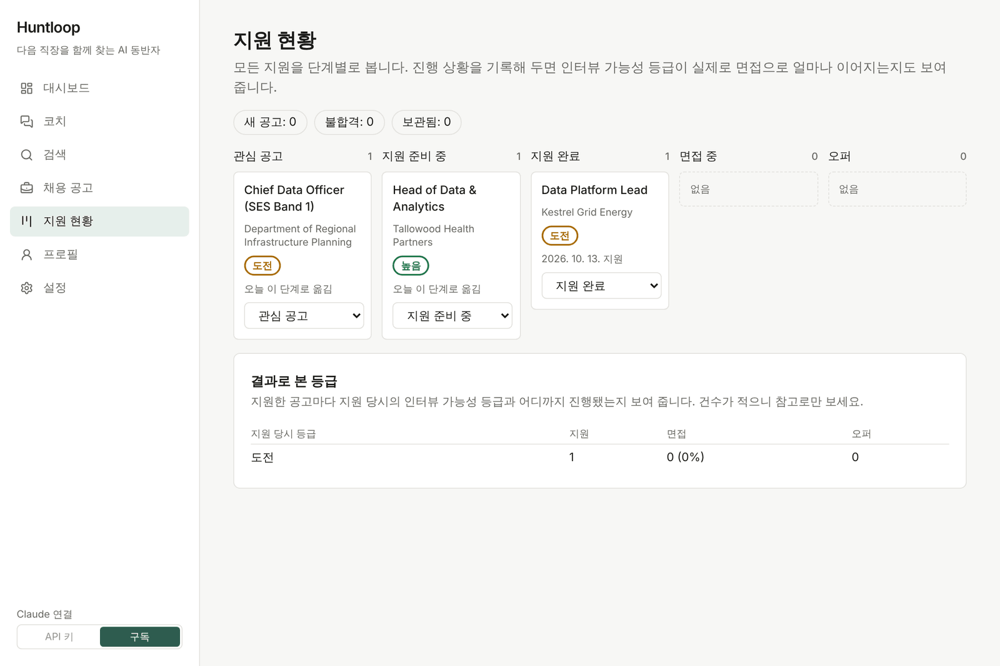
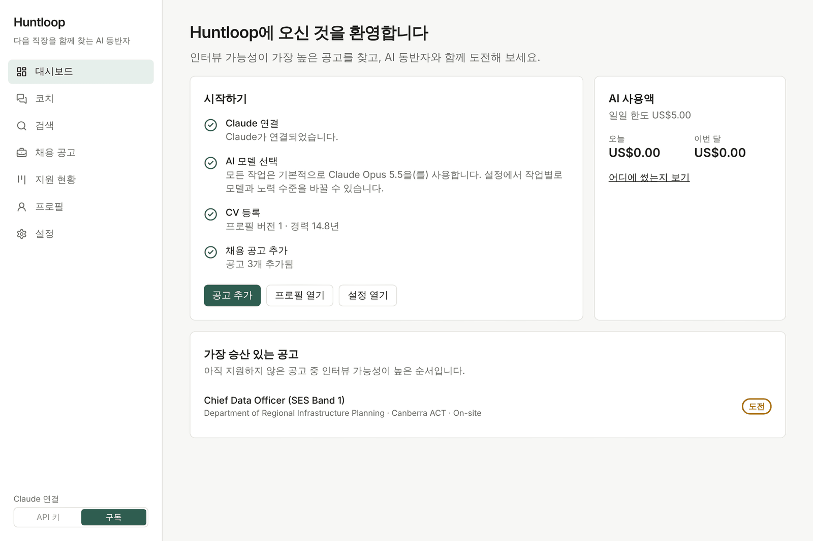
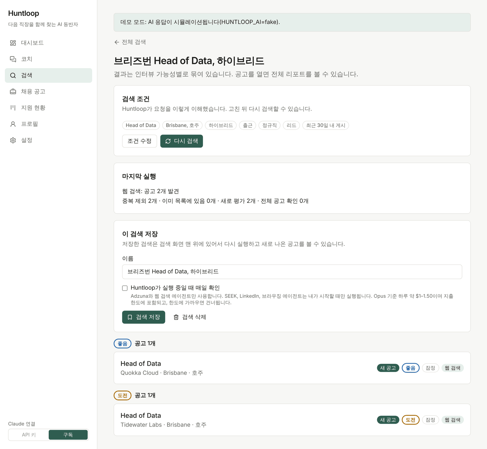
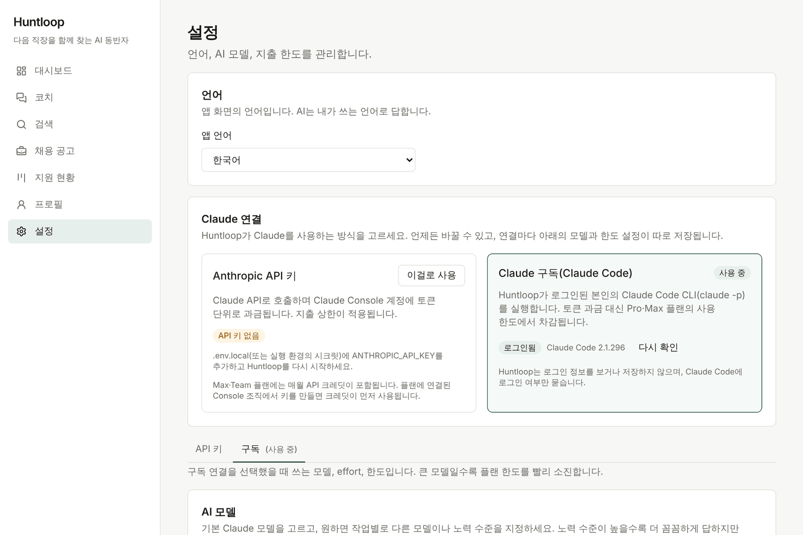
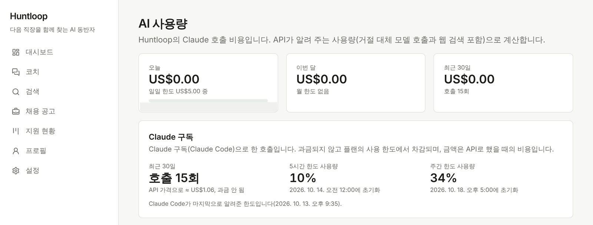

# Huntloop 안내서

[English](guide.md) | 한국어

간단한 소개는 [README](../README.ko.md)에 있고, 이 문서는 자세한 설명입니다.

## 프로필

CV를 올리거나(PDF, Word, 텍스트) 내용을 붙여 넣으면 Claude가 프로필로 정리합니다. 경력별 기간, 기술, 학력, 언어, 나라별
취업 자격까지 들어가고, 틀린 부분은 직접 고칠 수 있습니다. **희망 조건** 탭에서는 원하는 직함, 도시, 최소 연봉, 근무 형태
등을 정합니다.



## 공고 추가

공고 링크나 본문을 붙여 넣거나, 공고 스크린샷이나 PDF를 끌어다 놓으면 됩니다. Greenhouse, Lever, Ashby 링크는 공개 API로
읽고, 다른 링크는 안전장치를 거쳐 가져옵니다(구조화된 데이터를 먼저 보고, 없으면 본문을 읽습니다). SEEK와 LinkedIn은 따로
켜지 않는 한([아래 참고](#seek와-linkedin)) 자동으로 읽지 않으니, 본문이나 스크린샷을 넣어 주세요.

Huntloop는 공고를 요구 사항 단위로 나누고, 각 항목마다 공고의 원래 문장을 붙입니다. 그리고 항목마다 내 프로필을 맞춰
보면서 CV 문장을 근거로 인용합니다. 인용문은 공고와 CV에 글자 그대로 있는지 확인하고, 찾을 수 없으면 버립니다.

점수는 모델에게 숫자를 물어보는 게 아니라 코드로 계산합니다. 먼저 필수 조건(취업 자격, 시민권, 보안 인가, 근무지, 공고가
올라온 지 얼마나 됐는지)을 보고, 그다음 **높음**, **좋음**, **도전**, **낮음** 네 단계로 나눕니다. 일부러 퍼센트로 보여 주지
않습니다. 리포트에는 어떻게 하면 한 단계 올라갈 수 있는지가 나오고, CV만으로 알 수 없는 부분은 예/아니요로
물어봅니다. 답하면 AI를 다시 부르지 않고 바로 다시 계산합니다. 결과는 저장해 두기 때문에 같은 공고를 다시 열어도 비용이
들지 않습니다.



## 공고에 대해 물어보기

공고마다 **AI에게 묻기** 탭이 있습니다. 내 프로필, 공고, 분석 결과를 이미 알고 있는 Claude와 대화하는 곳입니다. 웹 검색도
하고, 메모를 남기거나 공고 상태를 바꿀 수도 있습니다. 프로필에 사실을 추가하자거나 지원을 진행하자고 제안할 수는 있지만,
내가 확인 버튼을 눌러야만 실제로 반영됩니다.



**회사** 탭에서는 회사를 조사합니다. 무슨 일을 하는 회사인지, 지난 1년간 무슨 일이 있었는지, 성장세, 경영진 변화, 채용
동향, 조직 문화, 주의할 점, 그리고 이게 내 지원에 어떤 의미인지까지 정리합니다. 모든 내용에 날짜가 있는 출처 링크가
붙습니다. 회사가 Greenhouse, Lever, Ashby를 쓰면 채용 중인 포지션 수는 그 채용 게시판에서 바로 가져옵니다. 리포트는 30일간
보관되고 대화에서도 참고합니다. (스크린샷 속 회사는 가상이라 이 화면은 넣지 않았습니다.)

## 맞춤 CV

지원하기로 했다면 **지원 진행 & CV 맞춤 작성**을 누르거나 대화에서 나온 제안을 수락하세요. 공고가 *지원 준비 중*으로 바뀌고
CV 탭에서 이 공고용 초안을 만들기 시작합니다.

Claude는 먼저 계획을 세웁니다. 내가 충족하는 요구 사항, 그에 해당하는 공고 속 키워드, 빼야 할 내용, 답해 주면 CV가 더
좋아질 질문 몇 가지를 정리합니다. 그다음 요약, 경력 항목, 기술을 공고의 언어와 그 나라 철자법에 맞춰 씁니다. 이름, 연락처,
직함, 회사, 기간, 학력, 취업 자격은 프로필에서 그대로 가져오기 때문에 모델이 바꿀 수 없습니다. 나라별 관례도 코드가
처리합니다. 사진과 생년월일은 넣지 않고, 호주와 뉴질랜드에서는 취업 자격 한 줄과 "References available on request"를 넣고,
미국은 Letter 용지를 쓰는 식입니다.

그리고 모든 문장을 검사합니다. 문장마다 CV(또는 내가 확인한 사실)에 실제로 있는 문장을 근거로 삼아야 하고, 그 근거는 같은
경력에서 나와야 합니다. 숫자는 근거 문장에 있는 숫자만 쓸 수 있고, 충족하지 못한 요구 사항은 내세울 수 없습니다. 검사를
통과하지 못한 문장은 표시되고, 지우거나 직접 고쳐 쓰거나 사실이라고 확인(그러면 프로필에 추가됩니다)해야 합니다. 표시된
문장이 남아 있으면 다운로드가 잠깁니다.



미리보기, 공고 키워드를 CV가 얼마나 담고 있는지(작성 전과 후), 예상 분량, Word와 PDF 다운로드가 제공됩니다. 파일은 한 단
구성에 표준 제목을 써서 지원자 관리 시스템(ATS)이 읽기 쉽게 만듭니다. 수정 요청은 CV 탭이나 대화에서 하면 되고, 새 버전도
똑같이 검사를 거칩니다. 이전 버전은 그대로 남습니다.

인터뷰 가능성은 맞춤 CV가 아니라 검증된 프로필만으로 계산합니다.

**프로필 → LinkedIn**에서는 목표 직무에 맞춘 LinkedIn 헤드라인, About, 경력 설명을 써 줍니다. 검사 기준은 CV와 같고,
LinkedIn 글자 수 제한(헤드라인 220자, About 2,600자, 경력 하나당 2,000자)도 지킵니다. 붙여 넣기는 직접 하셔야 합니다.
Huntloop는 LinkedIn에 로그인하지 않습니다.

## 지원 현황과 대시보드

**지원 현황**은 진행 중인 공고를 단계별로 보여 주는 보드입니다. 각 단계에 얼마나 머물렀는지도 나오고, 2주 동안 아무 변화가
없으면 연락해 보라고 알려 줍니다. 공고를 지원 완료, 면접 중, 오퍼, 불합격으로 옮길 때 날짜, 지원 경로, 면접 차수 같은
내용을 간단히 적어 둘 수 있습니다. 이렇게 쌓이면 등급별로 실제 면접까지 간 비율이 보이는데, Huntloop의 판단이 실제와
맞는지 확인하는 첫걸음입니다.



대시보드에는 아직 지원하지 않은 공고 중 가능성이 높은 순서대로 보여 줍니다.



**코치** 페이지도 있습니다. 구직 전체를 놓고 이야기하는 대화 창입니다. 이번 주에 뭘 하면 좋을지, 어떤 공고들을 비교해 볼지,
어디에 후속 연락이 필요한지 물어볼 수 있고, Huntloop에 있는 모든 공고를 볼 수 있습니다.

## 검색

**검색**에서 원하는 일자리를 평소 말투로(어떤 언어든) 적거나, 비워 두면 희망 조건으로 찾습니다. Huntloop가 이를 필터로
바꿔 보여 주고(직접 고칠 수 있습니다), [Adzuna](https://developer.adzuna.com/) API(무료 키, `ADZUNA_APP_ID`와
`ADZUNA_APP_KEY` 설정)와 회사 채용 페이지를 찾아보는 Claude 웹 검색 에이전트에서 공고를 모읍니다. 에이전트가 검색 결과에서
실제로 본 링크만 남기고, 마감된 공고는 뺍니다.

중복, 이미 목록에 있는 공고, 뻔히 안 맞는 공고(제외한 회사, 너무 오래된 공고, 다른 나라, 관련 없는 직함)는 AI를 부르기 전에
코드로 걸러 냅니다. 남은 것 중 관련성이 높은 공고는 빠르게 평가하고(검색 결과는 일부 내용뿐이라 *잠정*으로 표시합니다),
그중 가장 나은 몇 개는 공고 전체를 읽고 제대로 평가합니다. 몇 개까지 할지는 **설정 → 검색 한도**에서 정합니다.



검색을 저장해 두고 Huntloop가 켜져 있는 동안 매일 다시 돌릴 수도 있고, 관심 회사의 Greenhouse, Lever, Ashby 채용 게시판을
지켜볼 수도 있습니다. 지켜보는 건 무료이고(공개 API를 쓰고 희망 조건과의 비교도 코드로 합니다), 새 포지션을 평가하기로
했을 때만 비용이 듭니다. 매일 검색은 Adzuna와 웹 검색 에이전트만 씁니다. 끄려면 `HUNTLOOP_SCHEDULER=off`를 설정하세요.

### SEEK와 LinkedIn

두 사이트 모두 공고 검색 API가 없습니다. 그래도 쓰고 싶다면 Huntloop가 내 컴퓨터에서 눈에 보이는 Chrome 창을 띄워 직접
읽습니다(`data/browser-profile`에 별도 프로필을 씁니다). 둘 다 기본으로 꺼져 있고, **설정 → 공고 출처**에서 켤 때 경고가
먼저 나옵니다. 두 사이트 모두 이용약관에서 자동화된 접근을 허용하지 않고, LinkedIn은 자동화로 보이는 계정을 제한할 수
있습니다. 본인 구직 용도로, 본인 책임하에 쓰는 기능입니다.

켜 두더라도 내가 검색을 시작하거나 링크를 추가할 때만 사이트에 들어가고, 천천히 움직입니다(페이지 사이에 3~8초, 사이트별
페이지 수 제한). CAPTCHA, 로그인 요구, 보안 확인이 뜨면 내가 창에서 처리하거나 그 사이트를 건너뛸 때까지 멈춥니다.
자동화라는 걸 숨기거나 탐지를 피하려는 시도는 하지 않습니다. LinkedIn은 게스트 모드로 동작하고, 원하면 그 창에서 직접
로그인할 수 있습니다.

설치된 Chrome을 씁니다. 다른 Chrome이나 Chromium을 쓰려면 `HUNTLOOP_BROWSER_PATH`를 설정하고, 설정의 **브라우저 창
테스트**로 창이 열리는지 확인하세요.

### AI 브라우징 에이전트

전용 기능이 없는 채용 사이트는 [Chrome DevTools MCP](https://github.com/ChromeDevTools/chrome-devtools-mcp)를 통해 Claude가
같은 창을 직접 조작해서 볼 수 있습니다. 기본으로 꺼져 있습니다. 켜면 내가 등록한 다른 채용 사이트(예: 정부 채용 사이트),
SEEK나 LinkedIn 페이지 구조가 바뀌었을 때의 대안, 그리고 공고의 **회사 사이트에서 찾기**에 쓰입니다.

검색하고 읽는 것만 할 수 있습니다. 모든 동작은 브라우저에 닿기 전에 코드로 검사합니다. 지원, 로그인, 메시지, 연결 같은
버튼은 누를 수 없고, 검색창에 짧은 검색어만 입력할 수 있으며, 그 작업에 허용된 사이트 밖으로는 나가지 못합니다. 스크립트
실행, 파일 업로드, 네트워크 도구도 없습니다. 에이전트가 실제로 열어 본 공고만 인정하고, 그 페이지는 Huntloop가 다시 직접
읽습니다. 한 번 돌리는 데 Opus 기준 대략 $0.50~2 정도 듭니다.

## Claude 연결

**설정 → Claude 연결**에서 API 키와 Claude 구독을 언제든 바꿀 수 있고, 사이드바 아래쪽에도 작은 전환 버튼이 있습니다.
연결마다 모델, 노력 수준, 한도 설정이 따로 저장되니까, 구독에서는 Opus를 쓰고 API 키에서는 더 저렴한 모델을 쓰는 식으로
나눌 수 있습니다.



**API 키.** `.env.local`에 `ANTHROPIC_API_KEY`를 넣으면 됩니다. Claude Console 계정에 토큰 단위로 과금되고, Huntloop의 일간·
월간 지출 상한이 적용됩니다. Max·Team 플랜에는
[매월 API 크레딧](https://support.claude.com/en/articles/17154008-monthly-api-credits-for-max-and-team-plans)이 들어 있으니,
플랜에 연결된 Console 조직에서 키를 만들면 그 크레딧부터 씁니다.

**Claude 구독.** Huntloop가 로그인된 내 [Claude Code](https://code.claude.com)(`claude -p`)를 실행합니다. 그래서 따로 청구되지
않고 Pro나 Max 플랜의 사용 한도에서 차감됩니다.

1. Claude Code 설치: `npm install -g @anthropic-ai/claude-code`
2. 터미널에서 로그인: `claude auth login`
3. 설정에서 **다시 확인**을 누르고, 구독 카드의 **이걸로 사용**을 누릅니다.

Huntloop는 로그인 정보를 보거나 저장하거나 다른 곳으로 넘기지 않습니다. 수정하지 않은 `claude` 프로그램을 실행할 뿐이고,
로그인 여부는 `claude auth status`로만 확인합니다. 실행할 때마다 내 다른 환경과 분리됩니다. 빈 작업 폴더(`data/claude-code/`)
에서 돌고, 내 설정·훅·MCP 서버는 불러오지 않으며, 그 작업에 필요한 도구만 쓰고, Huntloop의 API 키도 넘기지 않습니다. 대화와
브라우징 에이전트는 `/api/claude-code/mcp`의 MCP로 Huntloop 기능에 접근하는데, 그 턴에서만 유효한 임의의 토큰을 씁니다.
`claude`가 PATH에 없으면 `HUNTLOOP_CLAUDE_PATH`를, Huntloop 주소가 `http://127.0.0.1:$PORT`가 아니면 `HUNTLOOP_ORIGIN`을
설정하세요.

플랜 한도는 평범한 개인 사용을 기준으로 잡혀 있어서, 큰 검색을 돌리면 금방 줄어듭니다. 모델 표에서 특정 작업(예: 선별
평가)만 API 키로 돌리게 지정할 수 있습니다. 한도에 닿으면 백그라운드 작업과 매일 검색은 한도가 풀릴 때까지 기다리고, 대화는
언제 다시 할 수 있는지 알려 줍니다. 대화 하나는 처음 시작한 연결을 계속 쓰니, 연결을 바꿨다면 새 대화를 시작하세요.

## 사용량과 비용

모든 작업은 기본으로 Claude Opus 5.5를 씁니다. **설정 → AI 모델**에서 기본 모델을 바꾸거나 작업별로 모델과 노력 수준을 따로
정할 수 있습니다. **AI 사용량** 페이지에는 오늘과 이번 달 지출(상한 대비), 30일 그래프, 작업별·모델별 내역이 나옵니다. 구독
호출은 따로 표시되고, API였다면 얼마였을지(실제 청구는 없음)와 Claude Code가 알려 주는 5시간·주간 사용량이 함께 나옵니다.



비용 감을 잡자면, 한국어 스크린샷을 찍으면서 한 작업 전부(CV 읽기, 공고 세 개 분석과 평가, 대화 답변 두 번, 맞춤 CV 하나,
짧은 회사 조사, 번역 몇 번)가 호출 15회, API 가격으로 약 $1.06이었습니다. Opus 기준으로 CV 읽기 약 $0.07, 공고 하나당 약
$0.16, 대화 답변 한 번에 약 $0.10, 맞춤 CV 하나에 약 $0.26 정도입니다. 회사 조사는 읽을 자료가 얼마나 많은지에 따라 다르고,
가장 비싼 건 브라우징 에이전트로 한 번에 $0.50~2, 저장한 검색을 매일 돌리면 하루 $1~1.50 정도 듭니다. 결과는 저장해 두므로
새 작업에만 비용이 듭니다. 지원하는 모델에서는 잘못된 거절이 나오면 실패로 끝내지 않고 다른 모델로 다시 시도합니다
(`fallbacks: "default"`).

## 개발

| 명령 | 하는 일 |
|---|---|
| `npm run dev` | 127.0.0.1:3000에서 개발 서버 실행 |
| `npm run build` / `npm start` | 프로덕션 빌드 / 서버 |
| `npm run lint` | ESLint (화면 문구가 모두 `messages/*.json`에서 오는지 검사하는 규칙 포함) |
| `npm run typecheck` | 라우트 타입 생성 + `tsc` |
| `npm test` | 단위 테스트 (Vitest, 가짜 AI와 대역 Claude Code CLI 사용) |
| `npm run test:live` | 로그인된 Claude Code로 돌리는 선택형 점검 (플랜 사용량을 조금 씀) |
| `npm run test:e2e` | 프로덕션 빌드와 가짜 AI로 돌리는 브라우저 테스트 (Playwright) |
| `npm run db:generate` | `src/server/db/schema.ts`를 바꾼 뒤 마이그레이션 생성 |

```
src/app/          페이지, 라우트 핸들러, 서버 액션 (Next.js App Router)
src/components/   UI
src/shared/       서버와 브라우저가 같이 쓰는 코드 (모델 목록, 설정, Zod 스키마)
src/server/       서버 전용: DB, Claude 클라이언트, AI 작업, 백그라운드 작업, 점수 계산
messages/         en.json, ko.json (화면에 나오는 모든 문구)
drizzle/          SQL 마이그레이션 (시작할 때 자동 적용)
tests/            unit/ (Vitest), e2e/ (Playwright), live/ (선택)
```

## 앞으로

실제 결과를 바탕으로 등급 기준 다듬기, 커버레터, 면접 준비, 코딩 테스트 연습.
