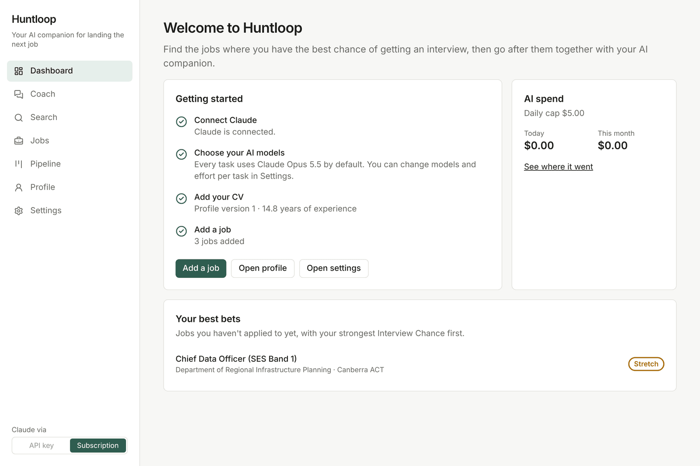
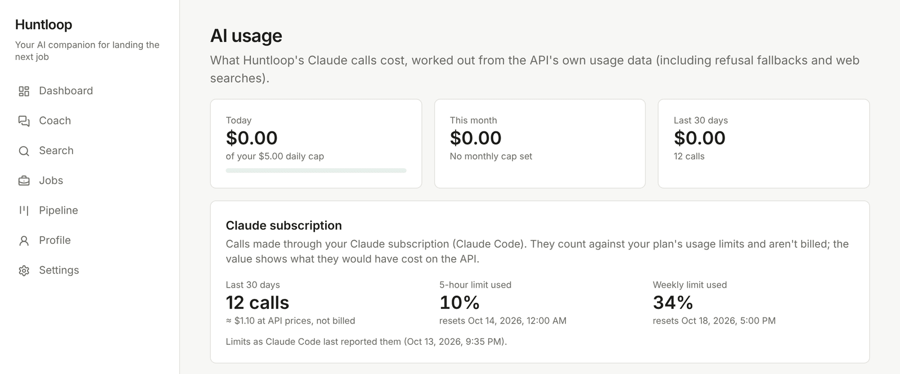

# Huntloop guide

English | [한국어](guide.ko.md)

The short version is in the [README](../README.md). This page has the details.

## Your profile

Upload your CV (PDF, Word or plain text) or paste it in. Claude turns it into a profile: each role with its dates,
skills, education, languages, and your work rights in each country. You can correct anything it got wrong. The Job
preferences tab is where you set the titles, cities, salary floor and kind of workplace you're after.


## Adding a job

Paste a link or the text of an ad, or drop in screenshots or a PDF of it. Greenhouse, Lever and Ashby links are read
through their public APIs, and other links are fetched carefully (structured data first, then the readable text). SEEK
and LinkedIn aren't read unless you turn them on ([see below](#seek-and-linkedin)), so for those you paste the text or
a screenshot.

Huntloop splits the posting into requirements, each with the exact sentence it came from, and checks your profile
against every one, quoting your CV as evidence. All the quotes are checked word for word against the posting and your
CV. If one can't be found, it's dropped.

The rating itself is worked out in code, not by asking the model for a number. Hard requirements come first: work
rights, citizenship, security clearance, location, and how old the ad is. Then the job gets a tier: **Strong**,
**Good**, **Stretch** or **Long shot**. There's no percentage on purpose. The report shows
what would move you up a tier, and where your CV doesn't say, it asks a yes/no question. Answer it and the job is
re-rated on the spot, without another AI call. Results are cached, so opening a job again costs nothing.


## Asking about a job

Every job has an **Ask AI** tab. It's a chat with Claude that already knows your profile, the posting and the analysis.
It can search the web, save notes and change the job's status. It can also suggest adding a fact to your profile, or
suggest going ahead with the application, but neither happens until you click to confirm.


The **Employer** tab researches the company: what it does, what it has been up to over the past year, growth,
leadership changes, hiring, culture, red flags, and what all that means for your application. Every claim links to a
dated source. If the employer uses Greenhouse, Lever or Ashby, the open-role counts come straight from its job board.
Reports are kept for 30 days and the chat can see them. (No screenshot of this one, since the employers above don't
exist.)

## Tailoring your CV

When you decide to apply, press **Proceed & tailor my CV**, or accept the chat's suggestion. The job moves to
*Applying* and the CV tab starts a draft for it.

Claude first plans what to lead with: the requirements you meet, the posting's own keywords for them, what to leave out,
and a few questions whose answers would make the CV stronger. Then it writes the summary, bullets and skills in the
posting's language and the local spelling. Your name, contact details, job titles, employers, dates, education and work
rights are filled in from your profile, so the model can't touch them. Local conventions are handled in code too: no
photo or date of birth, a work-rights line and "References available on request" in Australia and New Zealand, Letter
paper in the US, and so on.

Then every line gets checked. It has to rest on a quote that's really in your CV (or a fact you confirmed), from the
right role. Any number has to appear in that quote. Requirements you don't meet can't be claimed. A line that fails is
flagged, and you either remove it, rewrite it yourself, or confirm it's true, which adds it to your profile. Downloads
stay locked until nothing is flagged.


You get a preview, the share of the posting's keywords your CV covers before and after, a length estimate, and Word and
PDF downloads (single column with standard headings, which applicant-tracking systems read best). You can ask for
changes in the CV tab or in the chat. Each new version is checked again, and the old ones are kept.

Your Interview Chance is never worked out from the tailored CV, only from your verified profile.

**Profile → LinkedIn** writes a headline, an About section and role descriptions for the jobs you're targeting, with the
same checks plus LinkedIn's length limits (220 characters for the headline, 2,600 for About, 2,000 per role). You copy
them over yourself. Huntloop never logs in to LinkedIn.

## Pipeline and dashboard

The **Pipeline** board shows every job you're pursuing by stage and how long it has sat there, and reminds you to follow
up after two quiet weeks. When you move a job to Applied, Interviewing, Offer or Rejected, you can jot down a few details
(the date, how you applied, which interview round). Over time it shows how often each tier actually led to an
interview, which is a first step towards checking Huntloop's ratings against what really happens.


The dashboard lists your best bets: jobs you haven't applied to yet, strongest first.



There's also a **Coach** page, one chat about your whole search: what to focus on this week, which jobs to compare,
what needs a follow-up. It can see every job in Huntloop.

## Searching

On **Search** you describe what you want in plain words (any language), or leave it empty to use your preferences.
Huntloop turns that into filters you can edit, then gathers jobs from the [Adzuna](https://developer.adzuna.com/) API
(free key: set `ADZUNA_APP_ID` and `ADZUNA_APP_KEY`) and from a Claude web-search agent that looks at employers' own
careers pages. It only keeps links the agent actually saw in its search results, and drops ads that have closed.

Duplicates, jobs already in your list and obvious mismatches (excluded companies, too old, wrong country, unrelated
titles) are filtered out in code before any AI call. The most relevant jobs get a quick rating, marked *Provisional*
because search results are only excerpts, and the best few are read in full. How many is up to you in **Settings →
Search limits**.


You can save a search and have it re-run every day while Huntloop is running. You can also watch employers' Greenhouse,
Lever or Ashby job boards for new roles. Watching is free (public APIs, matched against your preferences in code) until
you choose to assess a role. Daily runs only use Adzuna and the web-search agent. Set `HUNTLOOP_SCHEDULER=off` to turn
them off.

### SEEK and LinkedIn

Neither site has a job-search API. If you want them anyway, Huntloop can read them in its own visible Chrome window on
your machine, using a separate profile in `data/browser-profile`. Both are off until you turn them on in **Settings →
Job sources**, and you'll see a warning first: their terms don't allow automated access, and LinkedIn may restrict
accounts it thinks are automated. It's meant for your own job hunt, at your own risk.

When they're on, Huntloop only visits them when you start a search or add a link, and it goes slowly (3 to 8 seconds
between pages, capped per site). If a CAPTCHA, sign-in wall or checkpoint shows up, the run pauses until you deal with
it in the window or skip the site. It doesn't hide that it's automated or try to get around detection. LinkedIn runs in
guest mode unless you choose to sign in yourself in that window.

It uses your installed Chrome. Set `HUNTLOOP_BROWSER_PATH` to use another Chrome or Chromium, and use **Test the browser
window** in Settings to check it opens.

### The browsing agent

For job sites with no built-in reader, Claude can drive that same window itself through
[Chrome DevTools MCP](https://github.com/ChromeDevTools/chrome-devtools-mcp). It's off by default. Once on, it's used
for other job sites you list (a government jobs board, say), as a fallback when SEEK or LinkedIn change their pages,
and for **Find on the employer's site** on a job.

It can only search and read. Every action is checked in code before it reaches the browser: clicks on things like
Apply, Sign in, Message or Connect are refused, it can only type short search terms, and it can't wander off the sites
allowed for that task. It has no script, upload or network tools. A job only counts if the agent really opened its page,
and Huntloop then reads that page itself. A run costs roughly $0.50 to $2 with Opus.

## Connecting Claude

**Settings → Claude connection** switches between an API key and your Claude subscription whenever you like, and
there's a small switch at the bottom of the sidebar too. Each connection keeps its own models, effort levels and limits,
so you could run Opus on the subscription and something cheaper on the API key.


**API key.** Put `ANTHROPIC_API_KEY` in `.env.local`. You're billed per token on your Claude Console account, and
Huntloop's daily and monthly spending caps apply. Max and Team plans include
[monthly API credits](https://support.claude.com/en/articles/17154008-monthly-api-credits-for-max-and-team-plans): create
the key in the Console organisation linked to your plan and those credits are used first.

**Claude subscription.** Huntloop runs your own signed-in [Claude Code](https://code.claude.com) (`claude -p`), so usage
comes out of your Pro or Max plan's limits instead of a bill.

1. Install Claude Code: `npm install -g @anthropic-ai/claude-code`
2. Sign in from a terminal: `claude auth login`
3. In Settings, press **Check again**, then **Use this** on the subscription card.

Huntloop never sees, stores or passes on your sign-in. It starts the unmodified `claude` binary and only asks
`claude auth status` whether you're signed in. Each run is kept apart from the rest of your setup: an empty working
folder (`data/claude-code/`), none of your own settings, hooks or MCP servers, only the tools that task needs, and no
access to Huntloop's API key. Chats and the browsing agent reach Huntloop's own tools over MCP at
`/api/claude-code/mcp`, with a random token that's only valid for that turn. If `claude` isn't on your PATH, set
`HUNTLOOP_CLAUDE_PATH`. If Huntloop isn't served on `http://127.0.0.1:$PORT`, set `HUNTLOOP_ORIGIN`.

A plan's limits are meant for ordinary personal use, and big searches eat into them quickly. You can pin individual
tasks (screening, say) to the API key in the model table. When a limit is reached, background work and daily checks wait
for the reset, and chats tell you when you can carry on. A chat thread stays on the connection it started with, so start
a new one after switching.

## Usage and cost

Every task uses Claude Opus 5.5 by default. In **Settings → AI models** you can change the default and set a different
model or effort level for each task. The **AI usage** page shows what you've spent today and this month against your
caps, a 30-day chart, and a breakdown by task and model. Subscription calls are listed separately, with what they would
have cost on the API (you aren't billed for them) and your plan's 5-hour and weekly usage as Claude Code reports it.



For a sense of cost: everything behind the English screenshots (reading the CV, three jobs analysed and rated, two chat
answers, one tailored CV and a short research run) took 12 calls, about $1.10 at API prices. With Opus that's roughly
$0.08 to read a CV, $0.16 per job, $0.10 per chat answer and $0.30 per tailored CV. Employer research depends on how
much there is to read. The browsing agent is the expensive one at $0.50 to $2 a run, and a daily saved search is about
$1 to $1.50. Results are cached, so you only pay again for new work. On models that support it, a false refusal is
retried on another model instead of failing (`fallbacks: "default"`).

## Development

| Command | What it does |
|---|---|
| `npm run dev` | Development server on 127.0.0.1:3000 |
| `npm run build` / `npm start` | Production build and server |
| `npm run lint` | ESLint, including a rule that every UI string comes from `messages/*.json` |
| `npm run typecheck` | Route type generation and `tsc` |
| `npm test` | Unit tests (Vitest, with simulated AI and a stand-in Claude Code CLI) |
| `npm run test:live` | Opt-in checks against your signed-in Claude Code (uses a little of your plan) |
| `npm run test:e2e` | Browser tests (Playwright) against a production build with simulated AI |
| `npm run db:generate` | Generate a migration after changing `src/server/db/schema.ts` |

```
src/app/          pages, route handlers and server actions (Next.js App Router)
src/components/   UI
src/shared/       code used on both server and client (model registry, settings, Zod schemas)
src/server/       server only: database, Claude client, AI tasks, background tasks, scoring
messages/         en.json and ko.json, every string the UI shows
drizzle/          SQL migrations, applied at startup
tests/            unit/ (Vitest), e2e/ (Playwright), live/ (opt-in)
```

## What's next

Checking the tiers against real outcomes and adjusting the weights, cover letters, interview prep, and practice for
technical tests.
